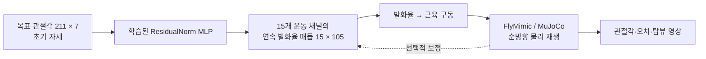
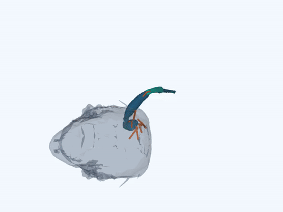
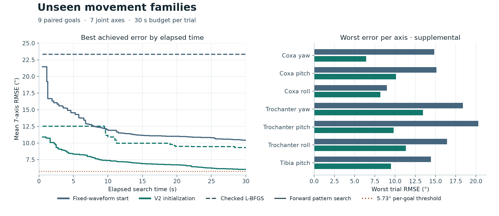

# Sensory Translator

초파리 시뮬레이터에 **목표 관절 궤적을 주면, 그 움직임을 만드는 연속 운동 발화율을 추정하는 Python 엔진**입니다. V2는 FlyMimic의 MuJoCo 근골격 모델에서 왼쪽 앞다리 관절 7축과 근육 15개를 제어합니다. Python API, CLI, 로컬 HTTP API와 탑뷰 실험 화면을 제공합니다.

학습에 사용하지 않은 합성 동작 3계열의 9개 목표에서, 목표에 맞춰 모델이 초기 발화율을 만들었을 때 같은 30초의 순방향 보정으로 평균 각도 RMSE가 **10.412°에서 6.056°**로 낮아졌습니다. 5.7296° 기준의 실패는 **9/9에서 3/9**로 줄었습니다. [실험 절차와 전체 결과](reports/unseen_motion_families_v2/README.md)

[설치](#설치) · [Python과 HTTP API](#python과-http-api) · [벤치마크](#미사용-동작-계열-검증) · [발표·시연 안내](docs/PRESENTATION_KO.md)

## 어떤 문제를 푸나

FlyMimic의 근골격 시뮬레이터는 근육을 구동하면 관절의 움직임을 계산합니다. 이 프로젝트는 그 순방향 계산을 이용해, 원하는 관절 움직임을 만들려면 어떤 구동 신호를 넣어야 하는지 역으로 찾습니다. 여러 발화율 조합이 비슷한 움직임을 낼 수 있으므로, 후보의 품질은 같은 물리 모델에서 재생한 관절 오차로 평가합니다. [FlyMimic 논문](https://proceedings.iclr.cc/paper_files/paper/2026/hash/222843b731e2c7813291586e2b39fe89-Abstract-Conference.html) · [FlyMimic 소스](https://github.com/gizemozd/FlyMimic)



| 단계 | 계약 |
| --- | --- |
| 입력 | 420 ms에 걸친 라디안 단위의 `211 × 7` 목표 관절각. 선택적으로 7축 초기 자세 변화량을 지정합니다. |
| 제어 범위 | 왼쪽 앞다리의 Coxa yaw/pitch/roll, Trochanter yaw/pitch/roll, Tibia pitch. 몸통은 고정합니다. |
| 모델 | `ResidualNormRateMLP`가 목표 궤적과 초기 자세를 받아 채널별 발화율을 추정합니다. 기본 체크포인트는 `20261116_v2_multijoint15_resnorm`입니다. |
| 출력 | 15개 운동 채널의 105개 시점 발화율 매듭. 이를 0–200 Hz로 제한하여 2 ms 간격의 구동으로 변환하고, 15개 근육 전체를 재생합니다. 실행에 교사 보조 근육 채널은 0개입니다. |
| 검증 | 목표 각도, 실제 시뮬레이션 각도, 관절별 오차와 발화율을 기록합니다. 선택한 근육 입력을 별도로 다시 재생합니다. |

발화율은 운동 채널별 초당 발화 횟수의 연속적인 제어 표현입니다. 전기 자극의 전압·전류나 전극 파형은 현재 출력 계약 밖에 있습니다. 별도의 스파이크·LIF 재생을 켜면 해당 경로의 관절 오차가 따로 기록됩니다. 현재 주 결과는 연속 발화율 재생에서 측정했습니다. [발화율 변환 코드](src/sensory_translator_v2/rate/bridge.py)

### 실행 모드

| 모드 | 동작 |
| --- | --- |
| `fast` | 학습된 모델이 만든 발화율을 물리에서 재생합니다. |
| `auto` | 빠른 후보가 지정 오차를 넘으면 설정된 횟수 내에서 보정을 시도합니다. |
| `refine` | 설정된 횟수 내에서 후보의 발화율을 추가 보정합니다. |
| `closed_loop` | 재생 중 시뮬레이션 관절각과 속도를 읽어 PD 피드백으로 근육 구동을 조정합니다. |

모델 학습에는 근육 입력을 역으로 맞춘 발화율과 실제 시뮬레이션 관절 오차를 사용했습니다. 호출할 때는 가중치를 고정하고, 보정 시 해당 목표의 입력 발화율만 변경합니다. 엔진은 기울기 검사를 통과한 보정 후보를 순방향 재생해 비교하고, 더 낮은 오차가 확인된 입력을 채택합니다. 상시 실행하는 물리 워커가 컴파일한 MuJoCo 모델을 재사용하고 각 재생의 초기 상태는 독립적으로 설정합니다. [학습 코드](src/sensory_translator_v2/rate/multijoint.py) · [멀티조인트 엔진 코드](src/sensory_translator_v2/engine/multijoint.py)

## 설치

Linux x86-64와 Python 3.11에서 확인했습니다. 엔진 wheel과 런타임 ZIP은 [GitHub v2.0.0a5 릴리스](https://github.com/IlleJiViN/sensory-translator-v2/releases/tag/v2.0.0a5)에서 다운로드합니다. wheel에는 SDK와 CLI가 들어 있습니다. 런타임 ZIP에는 wheel과 체크포인트, 물리 자산, 로컬 UI가 들어 있습니다. ZIP만 받았다면 먼저 wheel을 꺼냅니다. GitHub 릴리스의 자동 생성 소스 ZIP과 런타임 ZIP의 내용이 다릅니다.

```bash
python3.11 -m venv .venv
source .venv/bin/activate
python -m pip install 'torch>=2.4' --index-url https://download.pytorch.org/whl/cpu

python -m pip install './sensory_translator_v2-2.0.0a5-py3-none-any.whl[physics]'
sensory-engine-v2 install-assets ./sensory-engine-2.0.0a5-local-beta.zip
sensory-engine-v2 verify-assets
```

### 탑뷰 데모

```bash
sensory-engine-v2 run-multijoint --goal-family swing_scaled --scale 0.92 \
  --mode fast --output ./swing-result --render

sensory-engine-v2 serve --host 127.0.0.1 --port 8505 --ui \
  --model-id 20261115_v2_fastbridge_lowenergy
```

첫 명령은 목표·발화율·물리 궤적과 탑뷰 영상, 실행 기록을 저장합니다. 두 번째 명령으로 로컬 [Control Studio](http://127.0.0.1:8505/)에서 동작 프리셋을 고르고 관절별 목표와 재생 결과를 비교할 수 있습니다. 화면 없이 실행할 때는 `--render`를 빼고 필요하면 `MUJOCO_GL=disable`을 설정합니다. 영상 렌더링에는 호스트의 OpenGL/EGL 런타임이 필요합니다. [설치·빌드 상세](packages/sensory-translator-v2/README.md)



위 스윙 프리셋의 빠른 실행은 각도 RMSE 1.578°를 기록했습니다. 이 실행은 설치·렌더링 데모이며, 미사용 9개 목표 벤치마크는 아래에 별도로 기록했습니다.

## Python과 HTTP API

```python
from contextlib import closing

from sensory_translator_v2.engine import MultiJointEngine

with closing(MultiJointEngine()) as engine:
    goal = engine.goal_from_family(family="swing_scaled", scale=0.92)
    result = engine.run(goal["target_rad"], mode="fast", output="./swing-result")
    print(result["best_rmse_deg"])
    print(result["independent_replay_verified"])
```

직접 만든 목표는 축 순서가 일치하는 `211 × 7` 라디안 행렬을 `engine.run(target_rad)`에 넘깁니다. `best_rmse_deg`는 목표 대비 시뮬레이션 오차입니다. `independent_replay_verified`는 동일한 명령을 별도 물리 재생에서 다시 확인했다는 뜻입니다. 성공 기준 충족 여부는 `accuracy_threshold_met`에서 확인합니다. 단일 관절용 API는 `EngineV2`입니다.

HTTP 서버는 목표 생성, 비동기 실행과 결과 다운로드를 제공합니다.

| 요청 | 기능 |
| --- | --- |
| `GET /v2/capabilities` | 지원 동작, 제어 범위와 실행 모드 확인 |
| `GET /v2/multijoint/goal?family=swing_scaled&scale=0.92` | 7축 목표 궤적 생성 |
| `POST /v2/multijoint/jobs` | 목표 궤적과 옵션을 제출해 실행 |
| `GET /v2/jobs/{job_id}` | 실행 상태와 결과 확인 |
| `GET /v2/jobs/{job_id}/download` | 결과 번들 다운로드 |

서버 실행 후 요청 본문과 응답 정의는 [로컬 OpenAPI](http://127.0.0.1:8505/openapi.json)에서 확인할 수 있습니다. [OpenAPI 스키마 소스](src/sensory_translator_v2/engine/openapi.py)

## 미사용 동작 계열 검증

체크포인트를 고정하고, 학습·모델 선택에 쓰이지 않은 **순차 근육 펄스, 길항근 주파수 변화, 동시 수축 후 이완** 3계열에서 각각 3개씩 목표를 생성했습니다. 목표는 범위 내 발화율을 같은 MuJoCo 모델에 넣어 만든 궤적입니다. 최적화에는 목표 관절각과 초기 자세만 넘겼습니다. 각 목표 궤적과 가장 가까운 학습 궤적 사이의 RMSE는 10.72–22.86°였습니다.

직접 탐색은 목표와 무관한 기본 발화율에서, MLP 초기화는 목표에 따라 예측한 발화율에서 시작했습니다. 두 방법 모두 같은 저주파 탐색 방향 57개와 30초 제한을 적용하고 순방향 물리 오차로 후보를 골랐습니다. MLP 추론은 30초에 포함했고 준비 시간과 최종 독립 재생은 별도로 기록했습니다.

| 9개 목표 · 30초 순방향 탐색 | 직접 탐색 | MLP 초기화 + 같은 탐색 |
| --- | ---: | ---: |
| 초기 평균 RMSE | 23.347° | 12.541° |
| 최종 평균 RMSE | 10.412° | **6.056°** |
| 가장 큰 케이스 RMSE | 13.634° | **9.530°** |
| 기준 미달 | 9/9 | **3/9** |

목표별 RMSE는 211개 시점과 7축의 제곱 오차를 평균한 뒤 제곱근을 취한 값입니다. 표의 평균은 9개 목표의 RMSE를 평균한 값이며, 기준 미달은 개별 목표의 RMSE가 0.1 rad(5.7296°)를 넘는 경우입니다. MLP 초기화는 9개 목표 모두에서 직접 탐색보다 낮은 최종 오차를 냈습니다. MLP 초기화 후 남은 오차가 가장 컸던 축은 Trochanter yaw로, 목표별 최악 RMSE 13.440°, 최악 순간 절대오차 31.534°를 기록했습니다. 최종 명령 18개는 독립 재생에서 동일한 궤적을 냈습니다.

같은 목표와 예산을 사용한 물리 기울기 기반 L-BFGS 실험에서는 18회 중 15회가 기울기 검사에서 멈췄습니다. 최종 평균은 직접 초기화 23.347°, MLP 초기화 9.353°였으나 양쪽 모두 9/9가 기준에 미달했습니다. 표의 성능은 별도 순방향 탐색에서 나왔으며, 그 비교에서 달라진 것은 초기 발화율입니다.



[방법과 관절별 결과](reports/unseen_motion_families_v2/README.md) · [개별 시험 CSV](reports/unseen_motion_families_v2/trials.csv) · [관절별 최악 오차 CSV](reports/unseen_motion_families_v2/per_joint_worst.csv)

### 재현

위 패키지와 런타임 자산을 설치한 환경에서 동일 버전의 소스를 받습니다. 다음 두 스크립트는 각각 기울기 비교와 순방향 비교를 실행합니다. `--asset-root`에는 기본 설치 위치 또는 사용 중인 번들의 경로를 지정합니다.

```bash
git clone --branch v2.0.0a5 https://github.com/IlleJiViN/sensory-translator-v2.git
cd sensory-translator-v2
assets="${XDG_DATA_HOME:-$HOME/.local/share}/sensory-translator-v2/bundle"
PYTHONPATH=src python scripts/benchmark_v2_unseen_families.py \
  --asset-root "$assets" --output results/unseen_lbfgs --budget-s 30
PYTHONPATH=src python scripts/benchmark_v2_unseen_forward.py \
  --asset-root "$assets" --source results/unseen_lbfgs --output results/unseen_forward
```

본 실행에서는 Linux 논리 CPU 3개를 지정해 병렬화했습니다. 머신별 후보 평가량은 30초 안에 완료한 물리 재생 횟수에 따라 달라질 수 있습니다. 같은 환경에서 양쪽 방법을 쌍으로 비교하고 보고서에 생성된 목표·실행 기록을 남기는 방식으로 재현합니다. [시험 설정](reports/unseen_motion_families_v2/methods.json) · [목표 생성 기록](reports/unseen_motion_families_v2/targets.npz)

## 연구 범위와 이력

- **V2에서 확인한 것**은 한 시뮬레이션 환경에서 목표 관절 궤적을 발화율 명령으로 역추정하고, 실제 물리 재생으로 비교하는 과정입니다. 9개 목표는 몸통 고정 420 ms의 합성 과제입니다. 살아 있는 초파리 제어, 자연어 명령 수행, 전신 보행, 전극 자극 실험에서의 성능은 별도 검증이 필요합니다.
- **초기 청각 실험**은 합성 음원에서 사람 청각 모델과 초파리 청각 시뮬레이터의 반응 관계를 맞추는 실험이었습니다. 실제 음악 파일럿은 음원 준비 단계까지 진행했습니다.
- **이전 감각→운동 GNN 실험**은 시각·후각 자극에서 운동뉴런 막전위를 예측했습니다. 해당 실험의 주 기준에서 평균 예측과 ridge 회귀 기준선을 넘지 못했습니다. V2의 7축 역제어 경로는 목표각을 입력으로 받는 MLP와 근골격 물리 모델을 사용합니다.

## 출처

근골격 물리 모델은 Özdil et al.의 *Musculoskeletal simulation of limb movement biomechanics in Drosophila melanogaster* (ICLR 2026)를 사용합니다. V2 런타임 ZIP에는 FlyMimic의 물리 XML과 메시, 데모 `0002`의 참조 관절각 일부와 시뮬레이션에서 생성한 교사 롤아웃이 포함됩니다. [논문](https://proceedings.iclr.cc/paper_files/paper/2026/hash/222843b731e2c7813291586e2b39fe89-Abstract-Conference.html) · [FlyMimic 사용 버전](https://github.com/gizemozd/FlyMimic/tree/9ea11316) · [FlyMimic 라이선스](FlyMimic-LICENSE.txt) · [UI 제3자 고지](THIRD_PARTY_NOTICES.txt)
