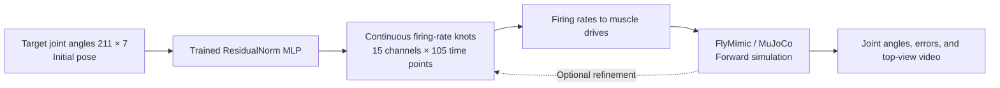

# REvFLY

REvFLY is a Python engine that **estimates the continuous motor firing rates needed to produce a target joint trajectory in a fruit fly simulation**. It controls seven joint axes and 15 muscles in the left front leg of FlyMimic's MuJoCo model. It provides a Python API, CLI, local HTTP API, and a control interface with top-view playback.

On nine synthetic targets from three motion families held out from training and model selection, starting the search from model predictions lowered mean joint-angle RMSE from **10.412° to 6.056°** under the same 30-second forward search. The number of targets above the 5.7296° threshold fell from **9/9 to 3/9**. [Benchmark protocol and full results](reports/unseen_motion_families_v2/README.md)

[Installation](#installation) · [Python and HTTP APIs](#python-and-http-apis) · [Benchmark](#held-out-motion-benchmark) · [Presentation and demonstration guide](docs/PRESENTATION.md)

## How it works

FlyMimic's musculoskeletal simulator takes muscle drives and computes joint motion. REvFLY uses that simulator to solve the inverse problem of finding muscle drives for a desired trajectory. Multiple firing-rate patterns can produce similar motion, so the engine evaluates candidates by replaying them in the same physics model and measuring joint-angle error. [FlyMimic paper](https://proceedings.iclr.cc/paper_files/paper/2026/hash/222843b731e2c7813291586e2b39fe89-Abstract-Conference.html) · [FlyMimic source](https://github.com/gizemozd/FlyMimic)



| Stage | Interface |
| --- | --- |
| Input | A `211 × 7` target joint-angle matrix in radians spanning 420 ms, with optional initial offsets for the seven axes. |
| Control scope | Left front leg coxa yaw, pitch, and roll, trochanter yaw, pitch, and roll, and tibia pitch. The body stays fixed. |
| Model | `ResidualNormRateMLP` estimates channel firing rates from the target and initial pose. The default checkpoint is `20261116_v2_multijoint15_resnorm`. |
| Output | 105 firing-rate knots per motor channel, constrained to 0–200 Hz and converted to muscle drives at 2 ms intervals. The engine drives all 15 muscles with the estimated rates. |
| Verification | Records the target and simulated joint angles, per-axis errors, and firing rates. Replays the selected muscle inputs in an independent run. |

The firing rate is a continuous control signal in spikes per second for each motor channel. The benchmark below uses continuous-rate replay. With optional explicit-spike or LIF replay, the engine reports the joint-angle errors for that path. Validation of electrical stimulation parameters and electrode waveforms is outside the experimental scope. [Firing-rate bridge](src/sensory_translator_v2/rate/bridge.py)

### Run modes

| Mode | Behavior |
| --- | --- |
| `fast` | Simulates the firing rates predicted by the trained model. |
| `auto` | Attempts refinement up to the configured iteration limit when the initial candidate exceeds the error threshold. |
| `refine` | Refines the candidate firing rates up to the configured iteration limit. |
| `closed_loop` | Adjusts muscle drives during replay with PD feedback from simulated joint angles and velocities. |

Training used firing rates fitted to muscle inputs and joint-angle errors measured in simulation. The model weights are fixed at inference. Refinement adjusts the firing rates for the current target. The engine replays candidates that pass the gradient check and keeps a candidate when replay confirms a lower error. A persistent physics worker reuses the compiled MuJoCo model and initializes each replay independently. [Training code](src/sensory_translator_v2/rate/multijoint.py) · [Multi-joint engine](src/sensory_translator_v2/engine/multijoint.py)

## Installation

Install the Python SDK and CLI from PyPI. [PyPI package](https://pypi.org/project/revfly/)

```bash
pip install revfly
revfly --version
```

You can also download and install the release wheel with `python -m pip install ./revfly-2.0.0-py3-none-any.whl`. [Release wheel](https://github.com/IlleJiViN/REvFLY/releases/download/v2.0.0/revfly-2.0.0-py3-none-any.whl)

To run simulations, install the `physics` extra in a Python 3.11 environment and install the runtime bundle. The bundle supplies the model checkpoints, FlyMimic assets, and local UI. This workflow was tested on Linux x86-64. [Runtime ZIP](https://github.com/IlleJiViN/REvFLY/releases/download/v2.0.0/revfly-2.0.0-local-beta.zip)

```bash
python3.11 -m venv .venv
source .venv/bin/activate
python -m pip install 'torch>=2.4' --index-url https://download.pytorch.org/whl/cpu
python -m pip install 'revfly[physics]'
revfly install-assets ./revfly-2.0.0-local-beta.zip
revfly verify-assets
```

For a direct wheel install with simulation support, use `python -m pip install './revfly-2.0.0-py3-none-any.whl[physics]'` in the same environment. If you installed the previous `sensory-translator-v2` distribution, run `python -m pip uninstall sensory-translator-v2` before installing `revfly` because the distributions share files and commands.

### Top-view demo

```bash
revfly run-multijoint --goal-family swing_scaled --scale 0.92 \
  --mode fast --output ./swing-result --render

revfly serve --host 127.0.0.1 --port 8505 --ui \
  --model-id 20261115_v2_fastbridge_lowenergy
```

The first command saves the target, firing rates, simulated trajectories, top-view video, and run metadata. The second starts the local interface to select a preset and compare the target to replay on each axis. For headless execution, omit `--render` and set `MUJOCO_GL=disable` if needed. Rendering requires the host's OpenGL/EGL runtime. [Local Control Studio](http://127.0.0.1:8505/) · [Installation and build details](packages/sensory-translator-v2/README.md)


The swing preset in fast mode reached a joint-angle RMSE of 1.578° in this installation and rendering demo.

## Python and HTTP APIs

```python
from contextlib import closing

from revfly import MultiJointEngine

with closing(MultiJointEngine()) as engine:
    goal = engine.goal_from_family(family="swing_scaled", scale=0.92)
    result = engine.run(goal["target_rad"], mode="fast", output="./swing-result")
    print(result["best_rmse_deg"])
    print(result["independent_replay_verified"])
```

For a custom target, pass a `211 × 7` matrix in radians in the expected joint-axis order to `engine.run(target_rad)`. `best_rmse_deg` is the simulated tracking error, `independent_replay_verified` confirms independent replay of the selected command, and `accuracy_threshold_met` reports whether the run met the accuracy threshold. Use `EngineV2` for the single-joint API.

The HTTP server supports goal generation, asynchronous runs, and result downloads.

| Request | Action |
| --- | --- |
| `GET /v2/capabilities` | Inspect available motions, control scope, and run modes. |
| `GET /v2/multijoint/goal?family=swing_scaled&scale=0.92` | Generate a seven-axis target trajectory. |
| `POST /v2/multijoint/jobs` | Submit a target trajectory and options. |
| `GET /v2/jobs/{job_id}` | Check progress and retrieve the result. |
| `GET /v2/jobs/{job_id}/download` | Download the result bundle. |

The running server exposes the request and response schemas through OpenAPI. [Local OpenAPI schema](http://127.0.0.1:8505/openapi.json) · [Schema source](src/sensory_translator_v2/engine/openapi.py)

## Held-out motion benchmark

With the checkpoint fixed, we generated three targets each from **sequential muscle-group pulses, variable-frequency antagonist drive, and coactivation followed by release**. These families were held out from training and model selection. Each target came from replaying in-range firing rates in the same MuJoCo model. Optimization received only the target joint angles and initial pose. Each target's nearest training trajectory was 10.72–22.86° away in joint-angle RMSE.

The direct search starts from a target-independent baseline waveform. MLP initialization starts from rates predicted for the target. Both methods used the same 57 low-frequency search directions and a 30-second budget, ranking candidates by simulated tracking error. The budget included MLP inference. Setup and final independent replay were timed separately.

| Nine targets, 30 seconds of forward search each | Direct search | MLP initialization + same search |
| --- | ---: | ---: |
| Initial mean RMSE | 23.347° | 12.541° |
| Final mean RMSE | 10.412° | **6.056°** |
| Worst target RMSE | 13.634° | **9.530°** |
| Targets above the threshold | 9/9 | **3/9** |

The target RMSE takes the square root of the mean squared error over 211 time points and seven axes. Mean RMSE averages these per-target values across nine targets. A target fails when its RMSE exceeds 0.1 rad (5.7296°). MLP initialization produced lower final error on all nine targets. Trochanter yaw had the highest remaining error with MLP initialization, with a worst-target RMSE of 13.440° and peak absolute error of 31.534°. All 18 selected commands reproduced identical trajectories on independent replay.

In a separate L-BFGS experiment using gradients from the physics model with the same targets and time budget, 15 of 18 runs stopped at the gradient check. The final mean error was 23.347° with direct initialization and 9.353° with MLP initialization. All targets exceeded the threshold (9/9) under both methods.


[Methods and results by joint axis](reports/unseen_motion_families_v2/README.md) · [Trial CSV](reports/unseen_motion_families_v2/trials.csv) · [Worst joint errors CSV](reports/unseen_motion_families_v2/per_joint_worst.csv)

### Reproduction

Install the wheel and runtime assets, then clone the matching source tag. The scripts run the gradient-based comparison and the forward search. Set `--asset-root` to the default installation path or to your runtime bundle.

```bash
git clone --branch v2.0.0 https://github.com/IlleJiViN/REvFLY.git
cd REvFLY
assets="${XDG_DATA_HOME:-$HOME/.local/share}/sensory-translator-v2/bundle"
PYTHONPATH=src python scripts/benchmark_v2_unseen_families.py \
  --asset-root "$assets" --output results/unseen_lbfgs --budget-s 30
PYTHONPATH=src python scripts/benchmark_v2_unseen_forward.py \
  --asset-root "$assets" --source results/unseen_lbfgs --output results/unseen_forward
```

The original runs were parallelized across three Linux logical CPUs. Hardware and system load affect how many physics rollouts fit within 30 seconds. Compare the methods in pairs on the same system and use the generated targets and run records to check the results. [Test configuration](reports/unseen_motion_families_v2/methods.json) · [Generated targets](reports/unseen_motion_families_v2/targets.npz)

## Research scope and history

- **REvFLY** turns target trajectories into firing-rate commands and compares the resulting motion in a single simulator. The nine targets are synthetic fixed-body tasks, each lasting 420 ms. Live fruit fly control, natural-language commands, whole-body walking, and electrode stimulation require separate validation.
- **Earlier audio experiments** aligned response patterns between a human auditory model and a simulated fruit fly auditory system using synthetic audio. The music pilot reached the audio preparation stage.
- **Earlier sensory-to-motor GNN experiments** predicted motor neuron membrane potential from visual and olfactory stimuli. The GNN fell below the mean predictor and ridge regression on the primary metric. REvFLY's seven-axis inverse controller uses an MLP conditioned on target angles and a musculoskeletal simulator.

## Credits

The musculoskeletal model is from Özdil et al., *Musculoskeletal simulation of limb movement biomechanics in Drosophila melanogaster* (ICLR 2026). The REvFLY runtime ZIP contains FlyMimic's physics XML and meshes, a subset of the reference joint angles from demo `0002`, and teacher rollouts generated in simulation. [Paper](https://proceedings.iclr.cc/paper_files/paper/2026/hash/222843b731e2c7813291586e2b39fe89-Abstract-Conference.html) · [FlyMimic revision](https://github.com/gizemozd/FlyMimic/tree/9ea11316) · [FlyMimic license](FlyMimic-LICENSE.txt) · [UI third-party notices](THIRD_PARTY_NOTICES.txt)
