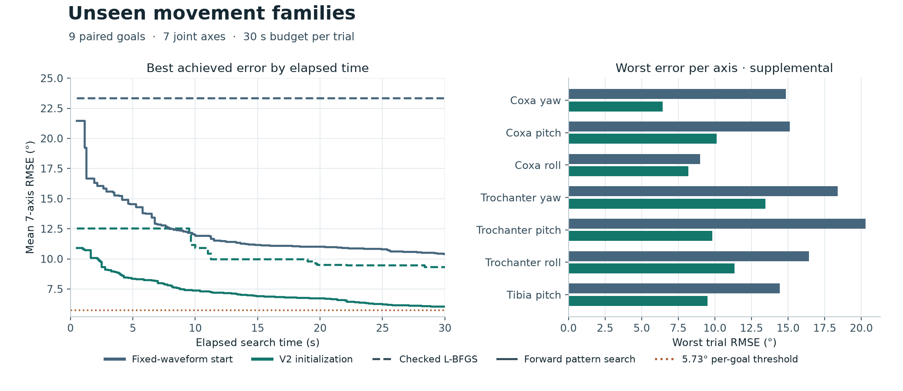

# V2 inverse control on unseen motion families

We tested whether a frozen V2 model provides a useful starting point for physics-based search on new joint trajectories. We generated 9 synthetic targets for the 7 left-foreleg joint axes, with 3 motion families held out from both training and model selection. Each initialization method had up to 30 seconds of search time per target.

## Results

| Experiment | Initialization | Initial mean RMSE | Final mean RMSE | Worst target RMSE | Above threshold |
|---|---|---:|---:|---:|---:|
| Planned L-BFGS with gradient checks | Shared waveform | 23.347° | 23.347° | 30.503° | 9/9 |
| Planned L-BFGS with gradient checks | V2 prediction | 12.541° | 9.353° | 24.377° | 9/9 |
| Follow-up forward physics search | Shared waveform | 23.347° | 10.412° | 13.634° | 9/9 |
| Follow-up forward physics search | V2 prediction | 12.541° | 6.056° | 9.530° | 3/9 |

**In the planned experiment, zero targets met the 5.730° threshold with either method.** Of the 26 gradient evaluations completed within the budget, 15 failed the finite-difference direction check. The check stopped all 9 shared-waveform trials and 6 V2 trials. Updates that improved the final error numbered 0 for the shared waveform and 11 for V2 predictions.

**In the follow-up experiment, V2 initialization reduced the final error on all 9 targets.** The final mean RMSE fell by about 42%, from 10.412° to 6.056°, and 6 targets met the threshold. Median search times were 29.788 seconds for the shared waveform and 29.822 seconds for V2 predictions. The two methods therefore used nearly the same time.



At each time point, the left plot averages the lowest error from the candidates completed so far for each target. The plot begins after all 9 targets have completed their first evaluation. The horizontal dashed line marks the threshold for an individual target.

### Follow-up results by motion family

| Family | Shared waveform final mean RMSE | V2 prediction final mean RMSE | Above threshold, shared / V2 |
|---|---:|---:|---:|
| Sequential muscle group pulses | 9.768° | 6.508° | 3/3 / 1/3 |
| Alternating antagonist activation with varying frequency | 12.524° | 6.436° | 3/3 / 2/3 |
| Coactivation followed by release | 8.943° | 5.224° | 3/3 / 0/3 |

### Worst joint-axis error in the follow-up experiment

| Left foreleg joint axis | Shared waveform max RMSE | V2 prediction max RMSE | Shared waveform max absolute error | V2 prediction max absolute error |
|---|---:|---:|---:|---:|
| Coxa yaw | 14.855° | 6.452° | 28.098° | 16.724° |
| Coxa pitch | 15.125° | 10.127° | 40.775° | 26.597° |
| Coxa roll | 9.003° | 8.196° | 23.531° | 17.261° |
| Trochanter yaw | 18.390° | 13.440° | 44.802° | 31.534° |
| Trochanter pitch | 20.294° | 9.820° | 44.591° | 22.486° |
| Trochanter roll | 16.415° | 11.334° | 45.668° | 27.026° |
| Tibia pitch | 14.436° | 9.509° | 40.686° | 23.073° |

## Test targets

- We froze the `20261116_v2_multijoint15_resnorm` checkpoint and the `adjacent_static_parent_v1` MuJoCo physics configuration. Model selection ended at epoch 24. The test targets were held out from training and model selection.
- The original data included 20 training trajectories and 10 model-selection trajectories. Each split contained four families, `swing_scaled`, `decoupled_group_swing`, `rhythmic_double_tap`, and `reach_and_hold`.
- We generated 3 targets from each new family. In `sequential_group_pulses`, pulses activate three muscle groups in sequence. In `chirped_antagonists`, antagonist activation alternates at varying frequencies. In `coactivation_release`, muscles activate together and then relax. The generator used the time-averaged teacher controls as a baseline and synthesized new temporal patterns. The RMSE from each test target to its nearest reference trajectory ranged from 10.72–22.86° for training and 14.66–25.57° for model selection.
- The simulator generated target joint trajectories from synthetic controls. Independent replay of the generating controls reproduced all 9 targets bit for bit. Optimization received only the target joint angles and the initial pose. We also independently replayed and verified all 36 sets of controls selected in the two experiments.
- Each target has 211 joint positions sampled at 2 ms intervals over 420 ms, across 7 joint axes. The optimizer controls 105 continuous firing-rate knots per muscle pool across 15 pools, with bounds of 0–200 Hz. The rate-to-control conversion uses a 100 Hz scale and a 2 ms time constant, producing a 210 × 15 muscle control array. The simulator replayed the generated muscle controls directly.

## Comparison protocol

`direct` starts from the target-independent waveform `base_knots_hz` in the model package. `model` starts from the firing-rate waveform predicted by the frozen V2 model for the given target. After initialization, both use the same search algorithm, firing-rate bounds, random seed, and physics settings. For each target, the methods run sequentially on the same CPU, with the order alternating across targets. The 30-second wall-clock budget includes initialization, physics evaluation of candidates, and candidate selection. The logs record shared warm-up and independent verification replay outside the search budget. Results include candidates that completed within the deadline.

The planned experiment used L-BFGS with firing-rate constraints. Each update required a finite-difference direction check on the physics gradient. The algorithm used an initial 1 Hz RMS step, a maximum 12 Hz RMS step, and an L-BFGS history of 5. A failed direction check ended the trial.

The follow-up experiment used the same forward pattern search for both initializations. The search varied firing rates along 57 directions that combine three temporal cosine bases and 19 directions in muscle space. It accepted candidates that reduced the physics replay error. The search began with a 6 Hz step and halved it after every full pass without improvement. The minimum step was 0.375 Hz.

- **Target RMSE** is the root mean square of the replay-minus-target joint angles over 211 time samples and 7 axes, expressed in degrees. **Final mean RMSE** is the arithmetic mean of the final RMSE values across targets.
- **Above threshold** counts targets with a final RMSE greater than 0.1 rad (approximately 5.730°). The criterion applies to the aggregate error across axes.
- **Max RMSE for a joint axis** is the largest time-series RMSE for that axis across targets. **Max absolute error** is the largest absolute angular difference for that axis across all time samples and targets.

## Reproduction

Install the Python package with its physics dependencies and prepare the verified runtime assets. Then run the commands below from the repository root in that environment. Set `ASSET_ROOT` to the verified bundle or to a local checkout containing the checkpoints and FlyMimic assets. The follow-up experiment reads the target and hash verification records written by the planned experiment. [Installation guide](../../packages/sensory-translator-v2/README.md)

```bash
ASSET_ROOT=/path/to/verified/runtime/bundle
python scripts/benchmark_v2_unseen_families.py \
  --asset-root "$ASSET_ROOT" --output results/unseen_family_reproduction/primary --budget-s 30
python scripts/benchmark_v2_unseen_forward.py \
  --asset-root "$ASSET_ROOT" --source results/unseen_family_reproduction/primary \
  --output results/unseen_family_reproduction/forward
```

The scripts and the checkpoint and physics asset hashes in `methods.json` record the experimental settings. The original runs pinned one worker to each of three Linux CPUs. To reproduce that layout, pass `--cpus` followed by three distinct available Linux logical CPU IDs to each command. Hardware and process load can change the final error because both experiments use a wall-clock deadline.

| File | Contents |
|---|---|
| [summary.csv](summary.csv) | 16 rows of RMSE and threshold failure counts by experiment, family, and method |
| [trials.csv](trials.csv) | 36 rows by target and method, including search time, replay verification, gradient check counts, and per-joint errors |
| [per_joint_worst.csv](per_joint_worst.csv) | 112 rows of worst errors by experiment, family, method, and joint axis |
| [time_curve.csv](time_curve.csv) | Best mean RMSE by elapsed time, as used in the plot |
| [methods.json](methods.json) | Planned and follow-up experiment settings, split and distance audits, seeds, hashes, and verification results |
| [targets.npz](targets.npz) | Synthetic target angles `target_rad` (9×211×7), initial pose offsets `initial_delta_rad` (9×7), inputs that reproduce the targets `witness_knots_hz` (9×15×105) and `witness_controls` (9×210×15), plus target names and families. Load with `numpy.load(..., allow_pickle=False)`. |

## Scope

The results cover 9 synthetic targets from one physics model and one initial pose, with three samples per family. We added the forward-search experiment after seeing direction checks fail in the planned experiment. The comparison measures the effect of initialization on simulated inverse control. Live-fly locomotion, sensory stimulation, spike timing, and electrode waveform accuracy require separate tests.
